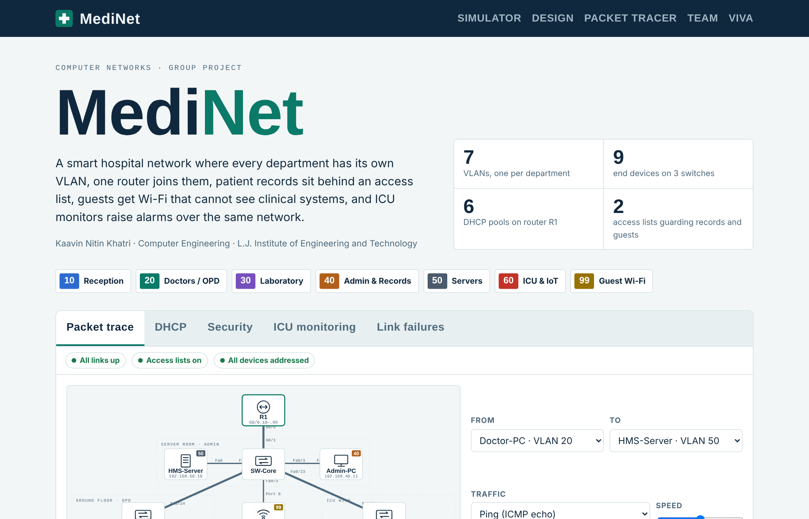
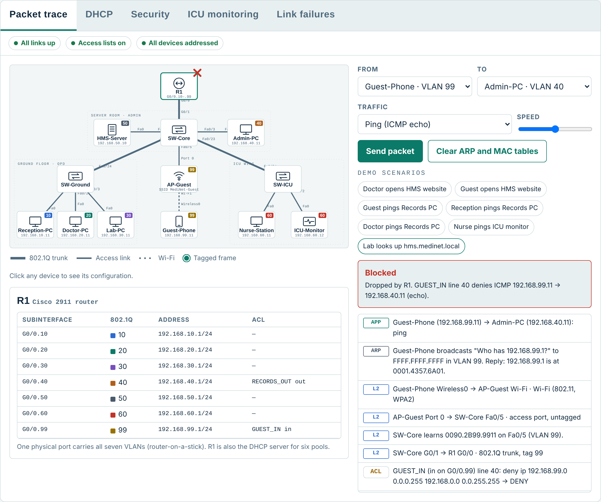
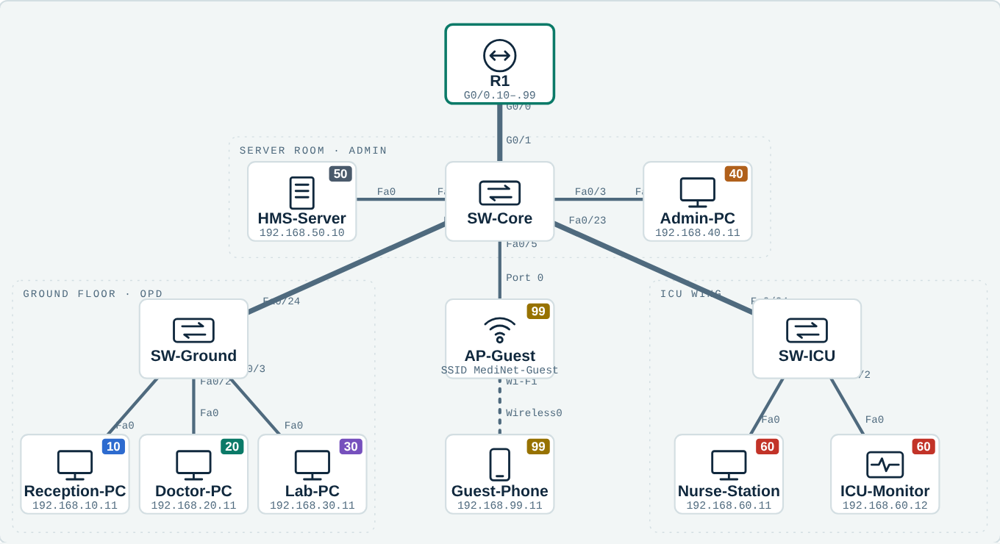

# MediNet: Smart Hospital Network

MediNet is a segmented hospital network built in Cisco Packet Tracer and modelled in a browser simulator that explains every packet. Seven departments sit on seven VLANs across three Cisco 2960 switches, joined by a Cisco 2911 router using router-on-a-stick. R1 hands out addresses from six DHCP pools, and the HMS server provides DNS and the hospital web portal. Two extended access lists protect the network: guests on WPA2 Wi-Fi reach only the portal, and the patient-records VLAN answers only doctors and servers. ICU alarms stay inside their own VLAN, so they still reach the nurse station when the core fails.

**Live demo:** https://kaavin-khatri.github.io/medinet-smart-hospital-network/

Computer Networks project · Kaavin Nitin Khatri · Computer Engineering, L.J. Institute of Engineering and Technology



## Simulator

| Tab | What it does |
| --- | --- |
| **Packet trace** | Pick a source, destination and traffic type (ping, web, DNS). An animated packet crosses the map, and the log lists every ARP, switch hop, 802.1Q tag, routing decision and access-list line. Click any device to see its configuration and its live ARP or MAC table. |
| **DHCP** | Release and renew any client and watch Discover, Offer, Request and Acknowledge with their real fields. |
| **Security** | Six departments against six services, each cell a real trace. Click a cell to see the deciding ACL rule, or switch the ACLs off to compare. |
| **ICU monitoring** | Six bedside monitors and three room sensors update every second; alarms travel to the nurse station and the server log. |
| **Link failures** | Cut any cable and see who loses service; a chart ranks every cable as a single point of failure. |



## Network design

| VLAN | Department | Subnet | Gateway | Devices |
| --- | --- | --- | --- | --- |
| 10 | Reception | 192.168.10.0/24 | 192.168.10.1 | Reception-PC |
| 20 | Doctors / OPD | 192.168.20.0/24 | 192.168.20.1 | Doctor-PC |
| 30 | Laboratory | 192.168.30.0/24 | 192.168.30.1 | Lab-PC |
| 40 | Admin and Records | 192.168.40.0/24 | 192.168.40.1 | Admin-PC |
| 50 | Servers | 192.168.50.0/24 | 192.168.50.1 | HMS-Server 192.168.50.10 (DNS, HTTP) |
| 60 | ICU and IoT | 192.168.60.0/24 | 192.168.60.1 | Nurse-Station, ICU-Monitor |
| 99 | Guest Wi-Fi | 192.168.99.0/24 | 192.168.99.1 | Guest-Phone (WPA2) |



## Packet Tracer results

| Test | Result |
| --- | --- |
| All clients set to DHCP | Each gets .11 (ICU-Monitor .12), gateway .1, DNS 192.168.50.10 |
| Doctor-PC → HMS-Server and Admin-PC | Replies, TTL 127 |
| Reception-PC → Admin-PC | Destination host unreachable (RECORDS_OUT) |
| Guest-Phone → Admin-PC, HMS-Server ping | Destination host unreachable (GUEST_IN) |
| Guest-Phone browser → hms.medinet.local | HMS portal loads |
| Nurse-Station → ICU-Monitor | Replies, TTL 128 (same VLAN, no router) |

## Run it

- **In a browser:** open the live demo, or download `index.html` and double-click it. It works offline.
- **Packet Tracer:** open `packet-tracer/MediNet.pkt` in Cisco Packet Tracer 8.x or 9.x. Configurations are in `packet-tracer/configs/`, and setup, demo steps and troubleshooting are in `packet-tracer/MediNet_PacketTracer_Guide.docx`.

## Repository contents

```
index.html                              Web simulator and project site (single file)
packet-tracer/MediNet.pkt               Cisco Packet Tracer lab (1 router, 3 switches, 1 AP, 8 end devices)
packet-tracer/configs/                  CLI configuration for R1, SW-Core, SW-Ground, SW-ICU
packet-tracer/MediNet_PacketTracer_Guide.docx
docs/MediNet_Project_Report.pdf         Project report (also .docx)
docs/MediNet_Presentation.pptx          15-slide presentation with speaker notes
docs/screenshots/                       Images used in this README
```

## Syllabus topics covered

VLANs · IEEE 802.1Q trunking · inter-VLAN routing (router-on-a-stick) · IPv4 addressing and subnetting · ARP · MAC learning · DHCP (DORA) · DNS · HTTP over TCP · TCP and UDP ports · ICMP · extended ACLs · wireless LAN (802.11, WPA2) · IoT monitoring · network reliability and single points of failure
